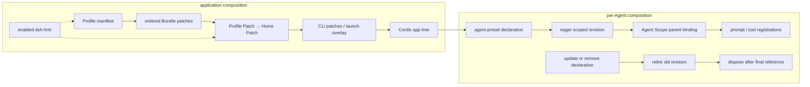

# 应用与 Session 的组合层

## 基线

DeepSeek Harness commit `f3803c96974ad4a94195fb97e5c637e9c2a3afe3`。

## 一句话结论

Profile、Bundle、Patch 组合应用；普通 Preset 声明与 Scope 组合 Agent。配置热重载由 YAML 中的 `dsh-hmr` 控制。Desktop 初始化自己的保留 Profile，并允许随附 CLI 在应用退出后管理其插件。

 **Claim `DSH-ARCH-004`:** Application Profile 按顺序组合 Bundle 与 Patch；随附 YAML 默认仅为 `web` 启用 Patch 热重载。

`headless`、`sdk` 与 `acp` 禁用 `dsh-hmr`，`sdk-minimal` 不挂载它；Profile Patch 可覆盖这些默认值。

 **Claim `DSH-ARCH-005`:** Agent Preset 为每个 Agent 组合能力，Scope 通过父子关系隔离并继承注册。

 **Claim `DSH-CAP-001`:** 固定基线发布 `web`、`headless`、`sdk`、`sdk-minimal` 与 `acp` 五个 Application Profile，并记录各自的 Bundle。

 **Claim `DSH-CAP-002`:** 固定基线发布 `standard`、`minimal`、`ptc` 与 `cordis` 四个 Agent Preset，并为它们配置不同的工具呈现。

 **Claim `DSH-DD-COMP-001`:** Profile 从空配置行开始，依次应用 Bundle、Profile Patch、Home Patch 与 CLI Patch。

 **Claim `DSH-DD-COMP-002`:** `dsh-hmr` 的 YAML 配置决定是否在运行时重载 Profile 组合。

热重载只在该插件启用时运行，不表示任意插件可在活动请求中无缝替换。

 **Claim `DSH-DD-COMP-003`:** Agent Preset 由普通插件声明完整的每 Agent 组合；Registry 按引用计数回收退役修订。

运行中 Agent 可保留旧修订，进程重启后按 Preset id 使用当前定义；替换完整 `config.plugins` 不会自动合并内置列表的后续更新。

 **Claim `DSH-DD-COMP-004`:** 上游架构文档描述了 `preset` Patch，但固定基线的组合调用链未见对应分派，不能据此认定该语法已可执行。

此结论限于固定提交的静态调用链核对，未运行上游；`preset` 描述不作为已验证的执行能力。

## 机制

### 组合归属

| 概念 | 作用域与位置 | 应用方式 |
|---|---|---|
| Profile | CLI 应用；`$DSH_HOME/profiles/<name>/package.json` | 指定有序 Bundle；重载由组合中的 YAML 决定。 |
| Bundle | npm manifest 的 `dsh.bundle.patch` | 指向单个或有序多个 Patch 文件，依次提供配置行。 |
| Patch | Bundle → Profile → Home → CLI | 按 id 替换完整 config，或插入配置行。 |
| Preset | `dsh-agent-preset` 普通插件行的 `config.plugins` | 声明完整子插件列表；Loader 行 id 用于编辑，`config.id` 用于 Session 身份。 |
| Scope | 内存中的 key 与父子关系 | Agent 绑定到 Preset 修订，继承 prompt、tools 等注册；Service 另按 Realm 解析。 |

Desktop 初始化并在运行中独占 `profiles/desktop` 及其包管理状态，以 Electron Node 模式运行私有 Host 和共享 Web 应用，默认用 `--port 0` 请求 OS 分配端口。CLI 不能启动该 Profile，因此它不计入五个 CLI 模板。Desktop 随附的 `dsh` 使用共享 CLI dispatcher：先启动 Desktop 完成初始化，再完全退出应用，就可执行 `dsh plugin --profile desktop add/list/remove`，下次打开 Desktop 时应用修改。该命令拒绝未初始化的 Desktop Profile，npm 安装的 `dsh` 不能修改它。[随附 CLI 与安装所有权](https://github.com/deepseek-ai/deepseek-harness/blob/f3803c96974ad4a94195fb97e5c637e9c2a3afe3/apps/desktop/README.md#L132-L146)说明共享数据与独立可执行依赖的区别。

### 两条组合链

启动器重写空根 `cordis.yml`，按 Bundle、Profile、Home、CLI 顺序叠加；启动 overlay 可再加入 telemetry 选择。启用的 `dsh-hmr` 监听 Profile manifest 与两个用户 Patch 文件，重读有序 Bundle 层，并与 Plugin Manager 的配置写入串行协调；包操作在该队列之外。启动器提供 Profile 数据和就绪状态，不自动安装 watcher。

Registry 不扫描 Preset 目录，也不接受路径或写回 YAML。新 Preset 与内置覆盖均由 Bundle Patch 声明：插入 `agent-preset` 行，或按行 id 修改配置。Web 的四个定义位于 `web-app/presets/*.patch.yml`。

最新[上游架构文档](https://github.com/deepseek-ai/deepseek-harness/blob/f3803c96974ad4a94195fb97e5c637e9c2a3afe3/docs/architecture.md#L25)新增了在声明的 `config.plugins` 内应用操作的 `preset` Patch 描述。静态源码核对发现，`composeEntries()` 直接把各层展平给 `applyEntryPatches()`；后者只有按条目 id 覆盖和 `insert` 分支，索引仅递归 `group` 的数组 `config`，并未进入 Preset 的对象 `config.plugins`。兼容性预检接收完成组合后的条目，没有增加 Preset selector 分派。因此本页保留该描述为文档与实现差异，不提供可执行的 `preset` Patch 示例；可核对的覆盖方式仍是重述声明的完整配置与子列表。

每个声明立即建立 Registry 所有的 Scope 和内存 Loader 树。声明更新或移除后，已绑定 Agent、子 Agent 和临时历史读取继续持有旧修订；最后一个引用释放时才清理退役树。子 Agent 的 `composeFrom()` 继承父 Agent 的同一修订。进程重启按日志中的 Preset id 查找当前定义，缺失定义拒绝恢复。

注册 Scope 的父链不传播 Cordis Entry 的 Service isolation。Preset 内的 Provider 与 Consumer 须共享一个 `cordis:group` Realm；组外的 `agent.ctx` 仍按 Host Realm 查找 Service。`agentPresets.serviceFor()` 显式读取 Agent 保留的组合；新 `inspectCompositions()` 查询 Registry 拥有的全部保留修订，传入 Agent Context 时只返回其确切修订的分离模块引用与泄漏诊断，不暴露 Loader 树或 Fiber。

Registry entry 的 volatile 字段 `selectedDefault` 保存用户默认值，新 Session 优先使用它，再回退到部署 `default`。`modeSelectionEnabled` 已退役：旧 Profile Patch 即使保留该字段，Registry 也不声明、读取或改写它。高层 `select()` 串行检查 Session：只运行独立命令而未开启 Turn 仍可切换，一旦有 open Turn 或 `lastTurn > 0` 就拒绝；底层 `recompose()` 由调用者保证空会话前提。

### 固定名录

`sdk-minimal` 是唯一不叠加 `dsh-base` 的 CLI 模板。下表为随附 YAML 的默认行为，Profile Patch 可以覆盖。

| Profile | 有序 Bundle（省略 `@deepseek-ai/dsh-`） | 默认配置热重载 |
|---|---|---|
| `acp` | `base` → `acp-app` | 禁用 HMR |
| `headless` | `base` → `headless` | 禁用 HMR |
| `sdk` | `base` → `sdk-app` | 禁用 HMR |
| `sdk-minimal` | `sdk-minimal` | 不挂载 HMR |
| `web` | `base` → `web-app` | 启用配置热重载 |

四个 Web Preset id 与产品模式如下；工具差异由[能力章节](../03-capabilities.md)集中说明。`cordis` 是 Creator mode 的权威 id，显示名称不产生另一个 Preset。

| Preset id | 声明 | 产品模式 |
|---|---|---|
| `cordis` | [cordis.patch.yml](https://github.com/deepseek-ai/deepseek-harness/blob/f3803c96974ad4a94195fb97e5c637e9c2a3afe3/packages/bundle/web-app/presets/cordis.patch.yml#L1-L10) | Creator mode |
| `minimal` | [minimal.patch.yml](https://github.com/deepseek-ai/deepseek-harness/blob/f3803c96974ad4a94195fb97e5c637e9c2a3afe3/packages/bundle/web-app/presets/minimal.patch.yml#L1-L10) | Minimal mode；Preset 自身提供持久 Shell、read_image 与 compaction，有效工具还可包含 Host 全局工具 |
| `ptc` | [ptc.patch.yml](https://github.com/deepseek-ai/deepseek-harness/blob/f3803c96974ad4a94195fb97e5c637e9c2a3afe3/packages/bundle/web-app/presets/ptc.patch.yml#L1-L10) | PTC mode |
| `standard` | [standard.patch.yml](https://github.com/deepseek-ai/deepseek-harness/blob/f3803c96974ad4a94195fb97e5c637e9c2a3afe3/packages/bundle/web-app/presets/standard.patch.yml#L1-L10) | Standard mode |

## 源码导读

| 主题 | 固定来源 | 核对重点 |
|---|---|---|
| Profile 名录与层次 | [模板](https://github.com/deepseek-ai/deepseek-harness/blob/f3803c96974ad4a94195fb97e5c637e9c2a3afe3/packages/util/official-bundles/src/bundles.ts#L9-L26)；[组合顺序与 YAML HMR](https://github.com/deepseek-ai/deepseek-harness/blob/f3803c96974ad4a94195fb97e5c637e9c2a3afe3/docs/architecture.md#L21-L29) | 模板只有有序 Bundle，重载取决于插件配置。 |
| Patch 与重载 | [Bundle、兼容性与 watcher](https://github.com/deepseek-ai/deepseek-harness/blob/f3803c96974ad4a94195fb97e5c637e9c2a3afe3/packages/boot/app-boot/README.md#L50-L65)；[失败策略](https://github.com/deepseek-ai/deepseek-harness/blob/f3803c96974ad4a94195fb97e5c637e9c2a3afe3/packages/boot/app-boot/README.md#L96-L115) | 完整 config 替换、被跳过的 Bundle 与局部失败。 |
| `preset` Patch 文档差异 | [架构描述](https://github.com/deepseek-ai/deepseek-harness/blob/f3803c96974ad4a94195fb97e5c637e9c2a3afe3/docs/architecture.md#L25)；[实际组合入口](https://github.com/deepseek-ai/deepseek-harness/blob/f3803c96974ad4a94195fb97e5c637e9c2a3afe3/packages/boot/app-boot/src/profile.ts#L747-L761)；[id 与 insert 分派](https://github.com/deepseek-ai/deepseek-harness/blob/f3803c96974ad4a94195fb97e5c637e9c2a3afe3/vendor/include/src/index.ts#L57-L123)；[兼容性预检](https://github.com/deepseek-ai/deepseek-harness/blob/f3803c96974ad4a94195fb97e5c637e9c2a3afe3/packages/boot/app-boot/src/compatibility-preflight.ts#L180-L186) | 没有把文档中的新描述当作已运行验证的语法。 |
| Preset 声明 | [id 与子列表](https://github.com/deepseek-ai/deepseek-harness/blob/f3803c96974ad4a94195fb97e5c637e9c2a3afe3/packages/preset/agent-preset/README.md#L40-L60)；[定义来源与限制](https://github.com/deepseek-ai/deepseek-harness/blob/f3803c96974ad4a94195fb97e5c637e9c2a3afe3/packages/preset/agent-preset-registry/README.md#L46-L60) | 不扫描目录、没有复制 API。 |
| 修订与回收 | [注册、退役与回收](https://github.com/deepseek-ai/deepseek-harness/blob/f3803c96974ad4a94195fb97e5c637e9c2a3afe3/packages/preset/agent-preset-registry/src/index.ts#L97-L168)；[Agent 引用与子级继承](https://github.com/deepseek-ai/deepseek-harness/blob/f3803c96974ad4a94195fb97e5c637e9c2a3afe3/packages/preset/agent-preset-registry/src/index.ts#L281-L326) | 退役且零引用后 disposal。 |
| 选择与恢复 | [select 门禁](https://github.com/deepseek-ai/deepseek-harness/blob/f3803c96974ad4a94195fb97e5c637e9c2a3afe3/packages/preset/agent-preset-registry/src/index.ts#L357-L382)；[进程重启限制](https://github.com/deepseek-ai/deepseek-harness/blob/f3803c96974ad4a94195fb97e5c637e9c2a3afe3/packages/preset/agent-preset-registry/README.md#L97-L99) | 运行中修订保留不等于跨重启保留。 |
| Service Realm 与组合检查 | [解析边界与 inspection](https://github.com/deepseek-ai/deepseek-harness/blob/f3803c96974ad4a94195fb97e5c637e9c2a3afe3/packages/preset/agent-preset-registry/README.md#L56-L62)；[Registry 所有的修订查询](https://github.com/deepseek-ai/deepseek-harness/blob/f3803c96974ad4a94195fb97e5c637e9c2a3afe3/packages/preset/agent-preset-registry/src/index.ts#L170-L187)；[保留组合的 Service 查询](https://github.com/deepseek-ai/deepseek-harness/blob/f3803c96974ad4a94195fb97e5c637e9c2a3afe3/packages/preset/agent-preset-registry/src/index.ts#L335-L343) | Scope 注册继承与 Cordis Service 解析分别负责不同边界。 |
| 默认 Preset | [字段与优先级](https://github.com/deepseek-ai/deepseek-harness/blob/f3803c96974ad4a94195fb97e5c637e9c2a3afe3/packages/preset/agent-preset-registry/src/index.ts#L56-L82)；[旧字段兼容](https://github.com/deepseek-ai/deepseek-harness/blob/f3803c96974ad4a94195fb97e5c637e9c2a3afe3/packages/preset/agent-preset-registry/README.md#L46-L48) | `selectedDefault` 优先，`modeSelectionEnabled` 不再参与决策。 |

## 限制与失败

| 情况 | 结果与责任 |
|---|---|
| id Patch 只写一个 config 字段 | 整个 config 被替换；修改者必须重述要保留的字段。 |
| Bundle 无法读取或与运行时不兼容 | 报诊断并跳过，保留选择记录和其余 Bundle 顺序；剩余组合仍可能缺少必需服务。 |
| 精确版本兼容性豁免 | 写在 Profile 的 `compatibility.json`；插件或 DSH 升级不会继承豁免，格式损坏时只读。 |
| Patch 语法或配置行结构无效 | 热更新被拒绝，运行配置保留；Profile 与用户 Patch 错误使启动失败。 |
| 有效更新中的插件导入或激活失败 | 报错并保留成功的其他条目；已有条目的 config schema 拒绝可保留原实例，没有整个更新的事务回滚。 |
| CLI 启动的必需条目无法激活 | dispose 应用并非零退出；后续 HMR 不重复必需项启动审计。 |
| Preset 导入、激活或全局 Service 泄漏失败 | 拒绝挂载，失败定义保留在名录中；等待 Host Service 的树在后续读和绑定时重审，不因启动先后立刻判死。 |
| 覆盖内置子列表 | 不自动合并后续内置更新；作者维护完整列表，不能依赖旧目录副本流程。 |
| 文档中的 `preset` Patch 描述 | 静态组合调用链未见对应分派；本手册不承诺该语法可执行。 |
| 已开启 Turn 后切换 Preset | 高层 `select()` 返回 `agent-preset/locked`，避免历史工具调用与当前能力失配。 |

名录仅描述固定提交发布的组合材料，不证明任意部署已经选用或成功激活它们。

## 继续阅读

- [所属核心章节：组合与生命周期架构](../02-architecture.md)
- [证据方法](../00-methodology.md) · [证据反向索引](../source-map.md)
- [Claim ledger](../../evidence/claims.json)
