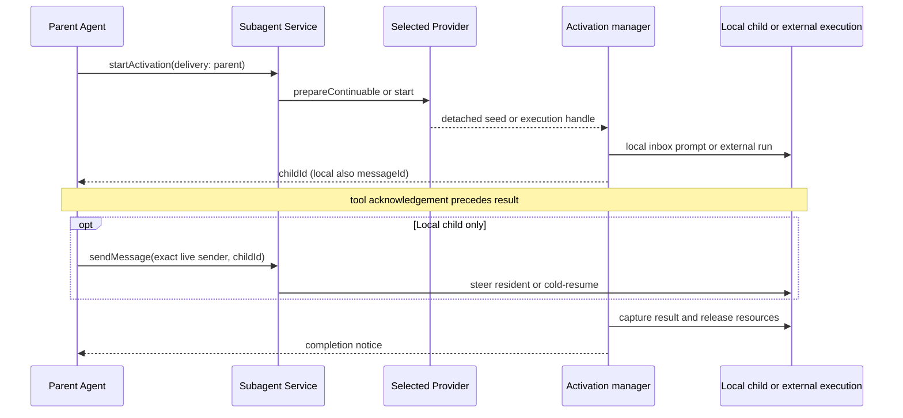
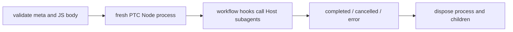

# Subagent、Goal、Plan mode 与 Workflow 的责任边界

## 基线

本章描述 DeepSeek Harness commit `d743267388641bc76f17c45ce8b4c231aed1d32c` 中的委托、目标状态、规划和程序化编排，并区分可选 Agent Teams 与随 Web 默认组合启用的 Schedule。源码链接固定到该提交；进程位置、发布族与默认启用状态分别核对。

## 一句话结论

| 原语 | 负责什么 | 主要限制 |
|---|---|---|
| Subagent | 委托一个 child Agent，Provider 决定初次 transport 与 conversation seed | Provider 可用和模型工具启用是两步 |
| Goal | 在一个 Session 中保存当前目标、phase、revision 与 admitted rounds | activation 为进程内状态，续轮策略由 Consumer 决定 |
| Plan mode | 保存协作状态，并在活动时向模型请求加入 guidance | approval 与 Sandbox 独立执行 |
| Workflow | 运行模型编写的 JS 程序，通过 hooks 批量编排 Subagent，可前台等待或后台运行 | 每次新建 Node 进程使用 Session 文件策略；VM 本身不提供安全隔离 |
| Agent Teams | 可选的持久成员 roster、direct peer inbox messages 与 shared task board | 实验性、共享 checkout、单进程协调 |
| Schedule | 保存 Host 任务，并在原会话投递一次性或周期 follow-up | Host 必须运行；到期可恢复 cold Session，投递回执不证明模型已执行 |

 **Claim `DSH-CAP-007`:** `standard` Preset 启用进程内 Subagent；Codex 与 Claude Code 的可选 Bundle 同时加入 Provider 与 global tool，其他外部 Provider 需要显式组合。

Provider 在 Host 中可用不等于模型已经获得对应工具。

 **Claim `DSH-CAP-008`:** durable current Goal 与通过 PTC Node 进程执行的 Workflow 是两种不同的编排原语。

Goal 状态不负责调度；Workflow 的 VM 不是安全隔离层，文件约束由所选 Sandbox 提供方执行，网络不在该策略内。

 **Claim `DSH-DD-ORCH-001`:** 同一个 Subagent Service 通过统一 Activation API 管理进程内 child 和外部执行；只有 local child 支持后续消息与 cold resume。

Provider 可注册不等于对应模型工具已在当前 Preset 中启用。

 **Claim `DSH-DD-ORCH-002`:** Goal 保存一个 durable current objective，并在进程内维护 activation。

Resume 或 Fork 后需要重新激活 Goal；Goal 本身不是调度器。

 **Claim `DSH-DD-ORCH-003`:** Workflow 程序复用 Node PTC runtime，每次在新建的 Node 进程中运行；Consumer 在完成或失败后仍须调用 Dispose。

文件约束和进程清理由所选 Provider 决定；Workflow 无整体 elapsed deadline，VM 与协作式 fan-out limits 不构成安全隔离或强制配额。

 **Claim `DSH-DD-ORCH-004`:** Agent Teams 已纳入公开发布族，保留 experimental 名称与实验成熟度，并由可选 Profile layer 显式启用。

## 机制

### Subagent Service 与 Provider

`ctx.subagents.startActivation()` 是统一入口：能力 flags 在启动前校验请求；具有 `prepareContinuable()` 的 Provider 提供 detached creation inputs，由 manager 创建 local Agent；其余 Provider 的 `start()` 提供一次 external execution handle。两者共享 admission、capacity、parent ownership、取消和 dispose，external execution 不获得多轮 conversation。[统一入口与 Provider contract](https://github.com/deepseek-ai/deepseek-harness/blob/d743267388641bc76f17c45ce8b4c231aed1d32c/docs/subsystems/subagent.md#L326-L379)。

| Provider | Transport 与 conversation seed | follow-up / cold resume | 默认工具归属 |
|---|---|---|---|
| `spawn` | 进程内新 Agent，无 parent conversation | 支持 | Standard 的 `subagent` |
| `fork` | 进程内 Agent，创建时固化 parent 最后一个已完成 Turn 及以前的前缀 | 支持 | Standard 的 `subagent_fork` |
| `acp` | 新 ACP subprocess/session，不复制对话 | 不支持 | 自行组合 Consumer |
| `codex` | app-server process 与独立 thread/Turn | 不支持 | 可选 Bundle 的 global `subagent_codex` |
| `claude-code` | CLI process 与独立 Agent SDK query | 不支持 | 可选 Bundle 的 global `subagent_claude_code` |
| `dsh-sdk` | 新 Harness subprocess，经 stdio JSON-RPC 驱动 | 不支持 | 自行组合 Consumer |

[spawn 实现](https://github.com/deepseek-ai/deepseek-harness/blob/d743267388641bc76f17c45ce8b4c231aed1d32c/packages/subagent/subagent-spawn-in-process/src/index.ts#L39-L56)与[fork 实现](https://github.com/deepseek-ai/deepseek-harness/blob/d743267388641bc76f17c45ce8b4c231aed1d32c/packages/subagent/subagent-fork-in-process/src/index.ts#L38-L80)给出 seed 差异；[Standard 工具行](https://github.com/deepseek-ai/deepseek-harness/blob/d743267388641bc76f17c45ce8b4c231aed1d32c/packages/bundle/web-app/presets/standard.patch.yml#L89-L121)决定 scoped 工具。Base 和 Standard 已移除旧 `backgroundMode` 配置。Codex/Claude Code Bundle 同时插入 Provider 与 global Consumer，选择后可供所有 Preset 使用，无需先复制 Preset；external result 保存在 parent Session，不创建 local child Session。[Codex Bundle](https://github.com/deepseek-ai/deepseek-harness/blob/d743267388641bc76f17c45ce8b4c231aed1d32c/packages/subagent/subagent-codex/README.md#L28-L77)；[Claude Code Bundle](https://github.com/deepseek-ai/deepseek-harness/blob/d743267388641bc76f17c45ce8b4c231aed1d32c/packages/subagent/subagent-claude-code/README.md#L28-L36)。

每个 local child 建立自己的 scope；conversation seed 不直接继承 parent 工具注册。启动前捕获 parent 显式 sandbox override，并把 child approval policy pin 为 `never`；Auto/Full access identity 只沿进程内路径继承，cold resume 重放 child 自己的日志。部署默认策略与一次性 grants 不被复制。[权限捕获](https://github.com/deepseek-ai/deepseek-harness/blob/d743267388641bc76f17c45ce8b4c231aed1d32c/packages/subagent/subagent/src/child-agent.ts#L235-L280)。外部 Codex/Claude Code 使用自己的 native permission 配置，不能假定等同于 parent Sandbox。[Codex native policy](https://github.com/deepseek-ai/deepseek-harness/blob/d743267388641bc76f17c45ce8b4c231aed1d32c/packages/subagent/subagent-codex/README.md#L40-L54)；[Claude Code native policy](https://github.com/deepseek-ai/deepseek-harness/blob/d743267388641bc76f17c45ce8b4c231aed1d32c/packages/subagent/subagent-claude-code/README.md#L40-L56)。

### 委托与 Activation 时序

模型工具统一返回 `started subagent <childId>`，不等待最终结果；local 启动返回的 `messageId` 只确认 inbox acceptance。manager 在资源释放和 completion notification 后结算 `result`，`dispose()` 的 cleanup failure 单独报告，不替换已捕获结果。后续 caller cancellation 不撤回已接纳的工作；持有 Activation 的程序化 Consumer 通过其 `dispose()` 取消该次执行。[Activation contract](https://github.com/deepseek-ai/deepseek-harness/blob/d743267388641bc76f17c45ce8b4c231aed1d32c/docs/subsystems/subagent.md#L28-L60)；[工具接纳与结果](https://github.com/deepseek-ai/deepseek-harness/blob/d743267388641bc76f17c45ce8b4c231aed1d32c/packages/subagent/tool-subagent/README.md#L56-L91)。

`sendMessage()` 只授权 exact live sender 与 adjacent local Agent：resident child 进入原 inbox，已释放 Activation 的 direct child 从自己的持久 Session/descriptor cold-resume；external backend 拒绝 follow-up。`delivery: 'parent'` 将最终文本、structured result、diagnostic 和 status 送回 parent；`delivery: 'caller'` 仅供 Consumer 收集，不发 settlement notice。[消息与投递](https://github.com/deepseek-ai/deepseek-harness/blob/d743267388641bc76f17c45ce8b4c231aed1d32c/docs/subsystems/subagent.md#L182-L184)。Local child 无论 delivery 都进入 parent catalog；external 仅在 parent delivery 下写 catalog。[local admission](https://github.com/deepseek-ai/deepseek-harness/blob/d743267388641bc76f17c45ce8b4c231aed1d32c/packages/subagent/subagent/src/manager.ts#L461-L473)；[external admission](https://github.com/deepseek-ai/deepseek-harness/blob/d743267388641bc76f17c45ce8b4c231aed1d32c/packages/subagent/subagent/src/manager.ts#L485-L511)。

child 初始 cwd 由请求或 parent 当前有效目录捕获，相对路径针对该有效目录解析。已有 child 不随后来的 parent `cd` 移动，cold resume 保留其 logged directory，原项目身份仍来自 parent。[目录捕获](https://github.com/deepseek-ai/deepseek-harness/blob/d743267388641bc76f17c45ce8b4c231aed1d32c/docs/subsystems/subagent.md#L9-L11)。

直接列表读取 parent `subagentCatalog`，descendant 列表递归遍历可达 catalogs；external rows 为 leaf，未出现在可达 catalog 中的 Session（包括普通 fork）不会被发现。`list_agents` 的 `running` / `inactive` 只描述活动，不证明任务完成或消息可达。[catalog 枚举](https://github.com/deepseek-ai/deepseek-harness/blob/d743267388641bc76f17c45ce8b4c231aed1d32c/docs/subsystems/subagent.md#L383-L389)。

### Goal 与 Plan mode

Goal 的 durable 事实来自 `goal/change`：目标文本、phase、revision 与轮数可重放。activation 为 process-local；任何 Session start 都把它 disarm，即使 durable phase 仍为 `active`，仍需显式 resume 才重新允许 continuation。上限是 admitted rounds，不是 token、费用或时间预算；completion 由 caller 记录，尚无 independent evaluator。[Goal 生命周期与恢复](https://github.com/deepseek-ai/deepseek-harness/blob/d743267388641bc76f17c45ce8b4c231aed1d32c/packages/goal/goal/README.md#L54-L82)；[Goal 限制](https://github.com/deepseek-ai/deepseek-harness/blob/d743267388641bc76f17c45ce8b4c231aed1d32c/packages/goal/goal/README.md#L157-L161)。同进程插件可直接写 Session 事件，strict replay 能检测 malformed/inconsistent records，但不隔离 trusted producer。

Plan mode 将 `plan/mode` 记录为 log-only 状态；模型请求读取由部署提供的 guidance。用户切换先成为 pending，下一次获准的 in-turn pre-step 才记录，因此 pending 选择可能在重启前尚未持久化。`exit_plan_mode` 提交完整 Markdown 计划给 user-question review，获准后记录待退出状态；同一批工具调用仍处于原 guidance。[Plan 日志与退出行为](https://github.com/deepseek-ai/deepseek-harness/blob/d743267388641bc76f17c45ce8b4c231aed1d32c/docs/subsystems/plan.md#L5-L35)。

### Workflow 运行生命周期

`workflow-ptc` 先验证 metadata、JS body、Provider 与 run limits，再调用 shared Node PTC runtime。它拒绝非 TypeScript runtime；Python PTC 组合必须禁用 `workflow-ptc`、`tool-workflow` 与任何启用的 Ralph。脚本保留 `agent()`、`parallel()`、`pipeline()`、`phase()`、`log()` 和 `args`；host binding 把 child 请求交给固定的 Subagent Provider。[Engine validation](https://github.com/deepseek-ai/deepseek-harness/blob/d743267388641bc76f17c45ce8b4c231aed1d32c/packages/workflow/workflow-ptc/src/index.ts#L97-L166)。

engine 分别捕获调用 Session 的 standing file policy 和有效 cwd；执行进程与该 Workflow 的 child 保留这次捕获的目录，program-visible environment 为空；网络不受文件策略约束。VM 的 withheld globals 约束脚本接口，不提供安全隔离；如果代码到达 Node，它仍由所选 OS 文件策略限制。初始同步片段有 `syncTimeoutMs`，整个 run 没有 elapsed deadline；前台执行仍受 caller signal 和 enclosing tool deadline 约束，取消立即终止 managed process 并取消 child。[执行、取消与 Provider 限制](https://github.com/deepseek-ai/deepseek-harness/blob/d743267388641bc76f17c45ce8b4c231aed1d32c/packages/workflow/workflow-ptc/README.md#L47-L61)。

`WorkflowRun.result` 以 `completed`、`cancelled` 或 `error` 收敛。Consumer 每条路径都必须调用 idempotent `dispose()` 并等待进程与 child cleanup；Workflow 没有独立的 cleanup timer。[Live run 约定](https://github.com/deepseek-ai/deepseek-harness/blob/d743267388641bc76f17c45ce8b4c231aed1d32c/docs/subsystems/workflow.md#L93-L110)。顶层 workflow Consumer 将 run/member 生命周期写入 parent Session，Web 以独立 Chat node 呈现；缺少末尾终止记录可表示中断。[Durable Chat records](https://github.com/deepseek-ai/deepseek-harness/blob/d743267388641bc76f17c45ce8b4c231aed1d32c/docs/subsystems/workflow.md#L122-L128)。

通用 `workflow` 工具默认支持 `run_in_background: true`，先返回 `jobId` 与 `runId`，由 owned Job 管理运行。后台不会继承该工具步骤的 signal；`job_kill`、界面停止操作或 owner teardown 负责取消。模型在完成时获得整体结果；结算前的 `job_output` 只报告状态，界面可展示 Job ring 中的 `phase()`、`log()` 与成员变化。[后台接纳与取消](https://github.com/deepseek-ai/deepseek-harness/blob/d743267388641bc76f17c45ce8b4c231aed1d32c/packages/workflow/tool-workflow/README.md#L32-L50)。

持久记录只包含顶层 run/member 生命周期；`workflow/phase` 与 `workflow/log` 的逐行进度通过临时 Job observation 提供，不写成可恢复的 Workflow 进度日志。嵌套 PTC transport 不写这四类记录，记录失败可留下不完整前缀。[Job 与持久记录的分工](https://github.com/deepseek-ai/deepseek-harness/blob/d743267388641bc76f17c45ce8b4c231aed1d32c/packages/workflow/tool-workflow/README.md#L68-L80)。

Standard 启用 engine 与通用 Workflow 工具；PTC Preset 默认禁用这两行，模型使用 `run_code`。Ralph 已从 Base/Preset 行移到默认关闭的实验 Bundle；启用后以独立 `workflowEngine` 的 Host group 暴露 global `ralph`，包括 Minimal 在内的所有 Preset 都可见。[Standard 行](https://github.com/deepseek-ai/deepseek-harness/blob/d743267388641bc76f17c45ce8b4c231aed1d32c/packages/bundle/web-app/presets/standard.patch.yml#L116-L122)；[PTC 行](https://github.com/deepseek-ai/deepseek-harness/blob/d743267388641bc76f17c45ce8b4c231aed1d32c/packages/bundle/web-app/presets/ptc.patch.yml#L116-L138)。

Ralph 的循环仍是前台、fresh child 与 bounded structured handoff；完成是 worker 自报，没有独立 evaluator。[Ralph Bundle](https://github.com/deepseek-ai/deepseek-harness/blob/d743267388641bc76f17c45ce8b4c231aed1d32c/packages/experimental/ralph-bundle/README.md#L28-L40)；[循环边界](https://github.com/deepseek-ai/deepseek-harness/blob/d743267388641bc76f17c45ce8b4c231aed1d32c/packages/experimental/tool-ralph/README.md#L158-L163)。

### Agent Teams 的发布状态

Agent Teams 包保留 `@deepseek-ai/dsh-experimental-*` 名称，但 metadata 声明 `publishConfig.access: public`；experimental 发布策略默认纳入 release family，固定基线的 private denylist 为空。它仍无稳定性承诺，默认 Profile 不启用。[Package metadata](https://github.com/deepseek-ai/deepseek-harness/blob/d743267388641bc76f17c45ce8b4c231aed1d32c/packages/experimental/agent-team/package.json#L1-L11)；[发布策略](https://github.com/deepseek-ai/deepseek-harness/blob/d743267388641bc76f17c45ce8b4c231aed1d32c/packages/experimental/AGENTS.md#L5-L9)；[private denylist](https://github.com/deepseek-ai/deepseek-harness/blob/d743267388641bc76f17c45ce8b4c231aed1d32c/scripts/experimental-package-policy.ts#L51-L65)。

Host Team Bundle 在 `dsh-base` 上装载 domain/tools，以 `spawn_teammate` 选择 fresh 或 fork，并禁用普通直接委托与重叠的全局 controls；Workflow 仍可独立创建 Activation 并收集结果。domain 以 Lead Session log 持久化 roster 与 task DAG，peer messages 则直接进入目标 Agent inbox，task mutation 仍使用 compare-and-set。成员共享工作目录，文件提示只产生冲突警告，不提供 worktree isolation 或文件锁。[Team Profile layer](https://github.com/deepseek-ai/deepseek-harness/blob/d743267388641bc76f17c45ce8b4c231aed1d32c/packages/experimental/agent-team-profile/README.md#L12-L51)；[Team 行为](https://github.com/deepseek-ai/deepseek-harness/blob/d743267388641bc76f17c45ce8b4c231aed1d32c/packages/experimental/agent-team/README.md#L126-L146)。

固定基线已把工具与 Web UI 合并为同一个 Team Bundle；旧的 `agent-team-web-profile` 独立条目需要移除。安装本身提供该可选 Bundle，但默认不选中，Web/Desktop Plugins 页面可显式启用。它只覆盖 Host rows，Preset 里的 scoped continuable controls 仍可能同时出现。[合并后的启用方式](https://github.com/deepseek-ai/deepseek-harness/blob/d743267388641bc76f17c45ce8b4c231aed1d32c/packages/experimental/agent-team-profile/README.md#L39-L51)；[组合限制](https://github.com/deepseek-ai/deepseek-harness/blob/d743267388641bc76f17c45ce8b4c231aed1d32c/packages/experimental/agent-team-profile/README.md#L101-L108)。

 **Claim `DSH-DD-ORCH-005`:** Agent Teams 的新消息直接进入目标 Agent inbox；Lead Session log 保存 roster 与 shared task 状态，旧 mailbox 记录只兼容读取。

返回 `messageId` 只确认接纳；未投递的历史 mailbox 消息不会自动恢复投递，共享 checkout 仍没有文件锁。

Team 验证 exact caller membership、拒绝 self-message，并按 sender-framed UTF-8 大小设限；发给 Lead 时直接 `steer()`，发给 teammate 时借 Host continuation path 授权 Lead-to-child edge，同时保留真实 sender。新消息不再写 `team/message/queued` / `delivered`，也没有额外 per-target ordering；排序属于目标 inbox。[direct peer delivery](https://github.com/deepseek-ai/deepseek-harness/blob/d743267388641bc76f17c45ce8b4c231aed1d32c/packages/experimental/agent-team/src/index.ts#L218-L247)；[历史 mailbox 边界](https://github.com/deepseek-ai/deepseek-harness/blob/d743267388641bc76f17c45ce8b4c231aed1d32c/packages/experimental/agent-team/README.md#L128-L146)。

### Schedule 与 Goal 的区别

Schedule 已随 Web 默认装载 service/UI；Standard、Cordis、PTC 在自己的 scope 中提供四个提醒工具与 time context，spawn/fork child 显式过滤这些工具。Goal 仍保存当前 objective/phase/round budget，不决定 wall-clock 调度。[Web Schedule service](https://github.com/deepseek-ai/deepseek-harness/blob/d743267388641bc76f17c45ce8b4c231aed1d32c/packages/bundle/web-app/cordis.patch.yml#L134-L140)；[Preset 工具与 child 过滤](https://github.com/deepseek-ai/deepseek-harness/blob/d743267388641bc76f17c45ce8b4c231aed1d32c/packages/bundle/web-app/presets/standard.patch.yml#L19-L35)；[spawn/fork filter](https://github.com/deepseek-ai/deepseek-harness/blob/d743267388641bc76f17c45ce8b4c231aed1d32c/packages/bundle/web-app/presets/standard.patch.yml#L93-L115)。

Schedule 的权威任务记录移到 Host `storage-domain`，支持 after、at、固定间隔 every、daily、weekly 与五字段 cron；后四种周期每次只补最新 missed occurrence。同 Session 的 due recurring tasks 可批成一个 follow-up；到期通过 Session controller 恢复 cold Session，再写 inbox 并要求 `session/flush` 确认。不能单独装载到没有 Web Session controller 的 headless/SDK 组合。[默认组合与时间规则](https://github.com/deepseek-ai/deepseek-harness/blob/d743267388641bc76f17c45ce8b4c231aed1d32c/packages/schedule/schedule/README.md#L26-L45)；[到期恢复与投递实现](https://github.com/deepseek-ai/deepseek-harness/blob/d743267388641bc76f17c45ce8b4c231aed1d32c/packages/schedule/schedule/src/runtime.ts#L85-L140)。

receipt 只证明 inbox 持久接纳，不证明模型已执行；Session flush 与 task-row put 是两次持久写，崩溃或 task-write failure 可能使已投递消息无回执并重复投递。管理和投递共享 FIFO，update 用 complete-record compare-and-set；archive 需先删除 active reminders，unarchive 不会恢复这些任务。旧 Session `schedule/change` 历史仅兼容读取，不自动迁移到 Host task table；缺失必需 title 的 Host task 会使整个 domain 打开失败。[投递与历史兼容](https://github.com/deepseek-ai/deepseek-harness/blob/d743267388641bc76f17c45ce8b4c231aed1d32c/packages/schedule/schedule/README.md#L63-L77)；[archive admission](https://github.com/deepseek-ai/deepseek-harness/blob/d743267388641bc76f17c45ce8b4c231aed1d32c/packages/schedule/schedule/README.md#L47-L55)。

Host 运行是投递前提；restoration、enqueue 或 persistence 失败后任务仍保存并警告，没有 automatic retry timer，之后的管理变更、另一次 timer wake 或 Host restart 才可能重试。提醒不投递到会话外；service 的 create/update 和 tool layer 拒绝 delegated child，不能靠恢复 child 绕过 root-only 限制。[当前失败与范围](https://github.com/deepseek-ai/deepseek-harness/blob/d743267388641bc76f17c45ce8b4c231aed1d32c/packages/schedule/schedule/README.md#L153-L162)。

## 源码导读

| 主题 | 固定来源 | 可核对行为 |
|---|---|---|
| Subagent | [Service 和 Provider contract](https://github.com/deepseek-ai/deepseek-harness/blob/d743267388641bc76f17c45ce8b4c231aed1d32c/docs/subsystems/subagent.md#L326-L402) | Activation contract、local/external Provider 与 continuation |
| Goal | [Goal README](https://github.com/deepseek-ai/deepseek-harness/blob/d743267388641bc76f17c45ce8b4c231aed1d32c/packages/goal/goal/README.md#L54-L82) | durable phase 与 process-local activation |
| Plan mode | [Plan subsystem](https://github.com/deepseek-ai/deepseek-harness/blob/d743267388641bc76f17c45ce8b4c231aed1d32c/docs/subsystems/plan.md#L5-L35) | pending state、pre-step append 与 review |
| Workflow | [Engine source](https://github.com/deepseek-ai/deepseek-harness/blob/d743267388641bc76f17c45ce8b4c231aed1d32c/packages/workflow/workflow-ptc/src/index.ts#L97-L166)；[生命周期记录](https://github.com/deepseek-ai/deepseek-harness/blob/d743267388641bc76f17c45ce8b4c231aed1d32c/docs/subsystems/workflow.md#L93-L128) | Node PTC runtime、cancel/dispose 与 Chat projection |
| Agent Teams | [Profile patch](https://github.com/deepseek-ai/deepseek-harness/blob/d743267388641bc76f17c45ce8b4c231aed1d32c/packages/experimental/agent-team-profile/cordis.patch.yml#L1-L29)；[发布规则](https://github.com/deepseek-ai/deepseek-harness/blob/d743267388641bc76f17c45ce8b4c231aed1d32c/packages/experimental/AGENTS.md#L5-L9) | opt-in 组合与实验成熟度 |
| Schedule | [Host 任务与投递](https://github.com/deepseek-ai/deepseek-harness/blob/d743267388641bc76f17c45ce8b4c231aed1d32c/packages/schedule/schedule/README.md#L65-L77) | Host task store、cold Session 恢复与持久 inbox 接纳 |

## 限制与失败

| 条件 | 可见结果 | 恢复责任 |
|---|---|---|
| Provider 无 `prepareContinuable()` | 通过 external `start()` 执行一次 | follow-up 需支持 local continuation 的 Provider |
| `startActivation()` 返回 | child identity 与 local inbox acceptance | 用 completion notice 或 Activation result 观察完成 |
| sender 不是授权的 direct parent/child | `UNAUTHORIZED` | 保留 exact live Agent 与合法邻接关系 |
| Goal Resume/Fork 后 phase 为 active | activation 仍 disarmed | 显式 resume Goal |
| Workflow 接入 Python PTC | engine 在 load 时失败 | 禁用 Workflow/Ralph 对应行或使用 Node runtime |
| Workflow 失败/取消 | 前台 `error`/`cancelled`；后台 Job `failed`/`killed` | holder 或 Job owner 仍等待 dispose；清理服从 Provider 约定 |
| Team 多成员修改同一 checkout | task hints 可提示冲突 | 调用方协调文件写入；没有文件锁 |
| Schedule 到期但 Session cold | Host controller 恢复 Session 并 follow-up | runtime 必须运行且 restoration/persistence 可用 |
| Schedule flush 成功但 task put 失败 | 可能已投递而缺 receipt | 不把提醒视为 exactly-once execution |

## 继续阅读

- [所属核心章节：能力与组合归属](../03-capabilities.md)
- [注册工具与 PTC](tools-and-ptc.md)
- [本地 Sandbox 执行边界](sandbox-execution.md)
- [证据方法](../00-methodology.md)
- [证据反向索引](../source-map.md)
